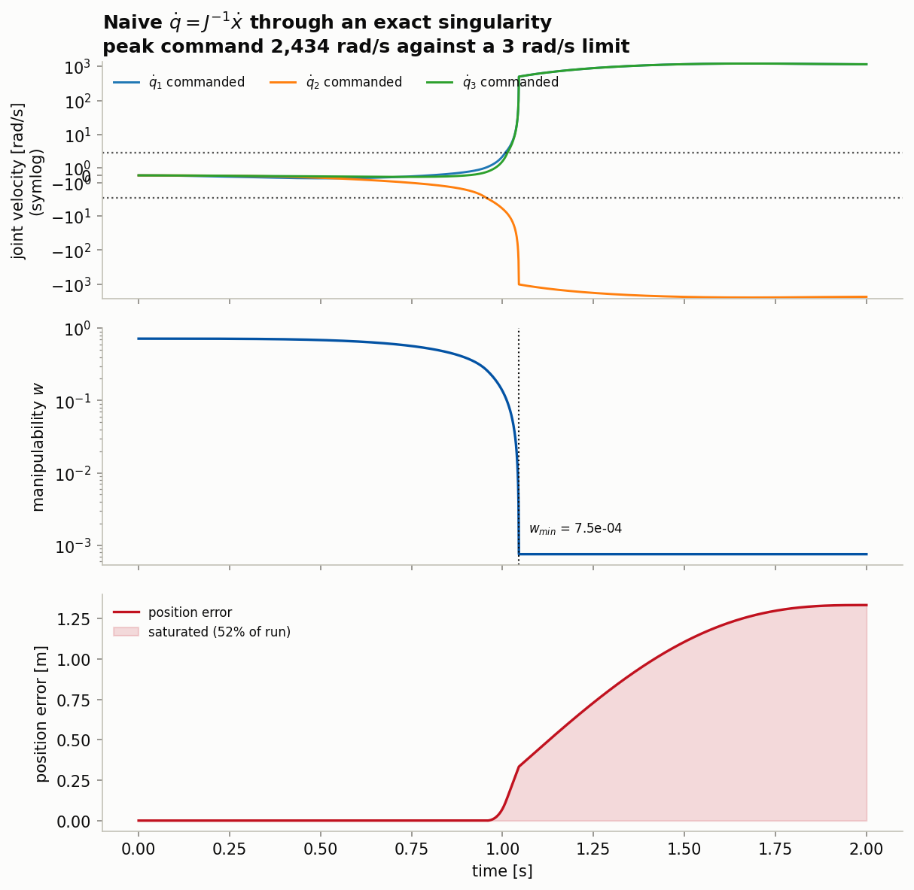
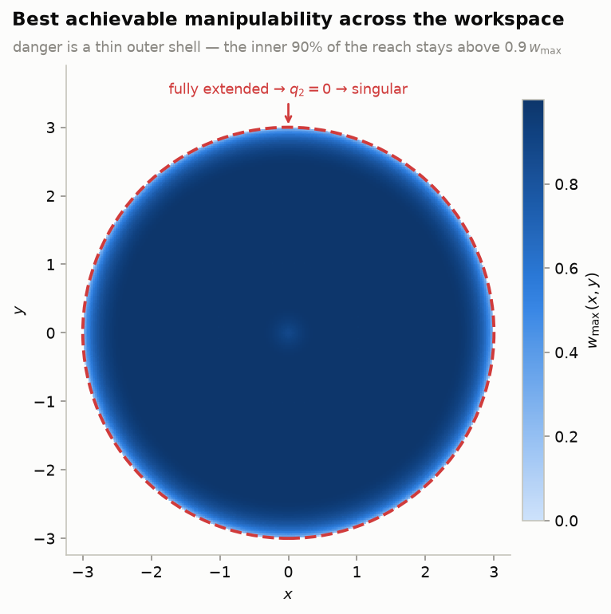

# singularity-robust-control

[](https://github.com/raahimnawaz/singularity-robust-control/actions/workflows/ci.yml)
[](LICENSE)
[](https://www.python.org/)

Detect an approaching kinematic singularity in a manipulator and switch to a
damped, singularity-robust velocity control law **before joint velocities blow
up** — then prove quantitatively that it beats a naive inverse-Jacobian
controller.

The testbed is a planar **3R arm** tracking its full end-effector pose
`(x, y, phi)`, so the Jacobian is square and the singularity is exact and
hand-derivable:

> **det(J) = l1 · l2 · sin(q2)**  →  singular exactly when `q2 ∈ {0, π}`
> (the first two links collinear), independent of `q1`, `q3`, and `l3`.

Manipulability is then `w = |det(J)| = l1·l2·|sin(q2)|`, and that scalar is what
the robust controller uses to schedule its damping.

## The headline result

Same arm, same trajectory, same 3 rad/s actuator limit. A straight task-space line
driven **exactly through** a singular configuration at the trajectory's peak speed:

| | naive `J⁻¹` | adaptive-λ DLS |
|---|---:|---:|
| peak commanded ‖q̇‖∞ | **2,434 rad/s** | **2.8 rad/s** |
| time saturated | **52.2 %** | **0 %** |
| position error RMS | **0.740 m** | **0.104 m** |
| position error max | 1.335 m | 0.217 m |

**875× less peak joint velocity, and it never asks the actuators for something they
cannot deliver.** The naive controller does not merely overshoot — it drives the arm
into the singular configuration, saturates for over half the run, and never recovers.



The honest part is what damping *costs*, which is why the comparison runs three
scenarios rather than one:


Read the left column: on a trajectory that never approaches a singularity, the
adaptive law is **bit-identical** to the naive inverse — its schedule returns
`λ = 0`, so there is nothing to pay. Fixed-λ damping, by contrast, is paying
1.2 mm of tracking error for protection nothing needed. That property is the
argument for scheduling damping rather than fixing it, and it is asserted in the
tests, not just plotted.

**And the part that cuts against the adaptive law.** Once you are *actually*
crossing a singularity, scheduling does not buy better protection than a
well-chosen constant `λ` — it is slightly worse:

| through-crossing | peak ‖q̇‖∞ | pos RMS | accel RMS |
|---|---:|---:|---:|
| fixed-λ (0.1) | **1.86** | **0.1025 m** | **2.5** |
| adaptive-λ | 2.78 | 0.1036 m | 4.2 |

Fixed-λ wins on every column of the headline scenario. So the case for
scheduling is *not* "it handles singularities better" — it is narrower and
should be stated as such: **scheduling costs nothing when damping isn't needed,
which is most of the workspace** (the inner 90% of the reach radius, per Phase
2), while a constant `λ` taxes every trajectory whether or not it goes anywhere
near a singular configuration. Adaptive-λ buys selectivity, not protection. If
you know in advance that every trajectory crosses a singularity, use fixed-λ and
skip the schedule.

Full numbers for all nine runs: [`results/metrics.md`](results/metrics.md).

## Status

| Phase | What | State |
|------|------|-------|
| 1 | Kinematics + analytical Jacobian + manipulability | ✅ done |
| 2 | Singularity map (workspace / joint-space heatmaps) | ✅ done |
| 3 | Naive `qdot = J⁻¹·xdot` controller — let it fail | ✅ done |
| 4 | Adaptive damped-least-squares controller — the contribution | ✅ done |
| 5 | Dependency-free C++ port at a 1 kHz control rate | ✅ done |
| 6 | *(stretch)* learned manipulability estimator | ⬜ |
| 7 | `ros2_control` plugin driving a Webots dynamic plant | ✅ runs; comparison pending |

See [`docs/PLAN.md`](docs/PLAN.md) for the full roadmap and
[`docs/derivation.md`](docs/derivation.md) for the hand derivation.

## Quickstart

```bash
uv venv --python 3.12
uv pip install -e ".[dev]"
uv run pytest -q
```

```python
import numpy as np
from armsim import RobotArm, forward_kinematics, jacobian, manipulability

arm = RobotArm(l1=1.0, l2=1.0, l3=1.0)
q = np.array([0.2, np.pi / 2, -0.4])

forward_kinematics(arm, q)   # end-effector pose [x, y, phi]
jacobian(arm, q)             # 3x3 analytical task Jacobian
manipulability(arm, q)       # w -> 0 near a singularity
```

## Where the singularities are (Phase 2)

```bash
uv run python -m armsim.run_heatmap        # writes results/
```

**In joint space** the map is flat in `q3` and zero exactly on `q2 ∈ {0, ±π}`.
That flatness is the visual proof of the derivation — folding link 3 does
*nothing* to conditioning, which is the opposite of an earlier guess about this
arm.


**In the workspace** the question isn't "what is `w` here" — a point can be
reached by several configurations with different `w` — but *how well-conditioned
can I be while standing here?* So the map shows the best case,
`w_max(x, y) = max{ w(q) : FK(q) = (x, y) }`.



The result is the headline of this phase, and it sets up Phase 3: **reaching far
costs conditioning, but only right at the end.** The inner **90%** of the reach
radius stays above `0.9·w_max`; the arm only has to straighten — driving
`q2 → 0` — in a thin outer shell. Danger is not spread across the workspace, so
the Phase 3 trajectory has to *aim* at a singularity to hit one.

**And it's checked, not asserted.** Because `q1` only rotates the arm and `w`
doesn't depend on it, `w_max` is a function of radius alone and has a closed
form — twice the area of the base–joint2–wrist triangle, by Heron:

```
w_max(r) = ½·√( ((l1+l2)² − r2²)·(r2² − (l1−l2)²) )   maximised over the
                                                     feasible wrist radius r2
```

A brute-force sweep of a few million configurations is then held to it. It never
wins, and the gap closes as the sweep refines — which is a test, not just a
picture:


## The control laws (Phases 3–4)

```
naive      qdot = J⁻¹ xdot
fixed      qdot = Jᵀ (J Jᵀ + λ²I)⁻¹ xdot,   λ constant
adaptive   qdot = Jᵀ (J Jᵀ + λ²I)⁻¹ xdot,   λ² = λ_max²(1 − w/w₀)² for w < w₀, else 0
```

All three share one explicit 3×3 cofactor inverse — no `np.linalg.solve`, no SVD.
That is not a micro-optimisation, it is the Phase 5 constraint: this has to become
dependency-free C++ inside a 1 ms budget, so it stays a fixed instruction sequence
with no allocation. Note the DLS form inverts `J Jᵀ + λ²I`, which is symmetric
positive-definite for any `λ > 0` — well-conditioned by construction even when `J`
itself is exactly singular. Avoiding the ill-conditioned inverse *is* the method.

### Where the damping goes


`λ` ramps continuously from 0 at the threshold to `λ_max` at the singularity.
Continuity is not cosmetic: a step in `λ` shows up as a joint-acceleration spike,
which is what the smoothness metric exists to catch.

### Choosing (w₀, λ_max)


The defaults (`w₀ = 0.30`, `λ_max = 0.20`) come from this sweep, not from taste —
it is the cheapest corner of the grid that reaches 0% saturation.

**The surprise here is that the trade-off is weak.** Pushing `w₀` from 0.05 to
0.30 cuts peak commanded velocity roughly 6× *while tracking error slightly
improves*. Damping earlier is nearly free, because in this regime the error was
coming from saturation rather than from the damping. The genuine cost only appears
at `λ_max = 0.4`, where the error curve turns back upward. A weak trade-off is
still worth plotting — the interesting claim is that it is weak, and that is only
credible with the grid shown.

## The C++ port (Phase 5)

```bash
cmake -S cpp -B cpp/build -DCMAKE_BUILD_TYPE=Release
cmake --build cpp/build
cpp/build/armctl_main out.csv     # regenerate + check by eye
ctest --test-dir cpp/build --output-on-failure   # parity vs the Python golden CSV
```

`cpp/include/armctl/` is a header-only, dependency-free port of the exact math
above — `mat3.hpp` (fixed 3×3 arithmetic, the same cofactor `det3`/`inv3`),
`kinematics.hpp`, `controllers.hpp`, `trajectory.hpp`, and `sim.hpp` (the RK4
closed loop). `cpp/src/main.cpp` runs the through-singularity / adaptive-DLS
scenario — the run that produced `results/golden_through.csv` — and
`cpp/tests/parity_check.py` (stdlib-only, no numpy) holds every field of its
output to that CSV within `1e-9`.

**Why time `step_control()` alone, not the full RK4 step.** The simulation
evaluates the control law four times per step because RK4 is a four-stage
integrator; that is a Python/C++ parity choice (see `armsim/sim.py`), not
something a real digital controller does. A real 1 kHz loop calls the control
law exactly once per tick, so that is the one call timed:

| | median | p99 | max | budget | headroom at p99 |
|---|---:|---:|---:|---:|---:|
| `step_control()` | ~0.1 µs | ~0.2 µs | low single-digit µs | 1,000 µs (1 kHz) | ~5,000× |

(Numbers from a representative run — `max` is noisy at this timescale, as any
wall-clock measurement of a sub-microsecond call is; median and p99 are the
numbers that matter. Run `cpp/build/armctl_main` yourself for a fresh sample.)

That headroom is expected, not a finding — for a `3×3` `J`, a cofactor
determinant and adjugate inverse are a fixed handful of FLOPs, nanoseconds on
any modern core. The honest framing (also in `docs/PLAN.md`, Phase 6) is that
this result is the *baseline* a learned or SVD-based estimator would have to
beat on a high-DOF arm, not evidence that this particular 3×3 solve was ever
at risk of missing a 1 ms budget.

## On a real dynamic plant (Phase 7)

Everything above runs against a **kinematic** plant: `armsim/sim.py` integrates
`q̇` straight from the control law, with saturation applied plant-side. No mass,
no inertia, no torque limit, no actuator bandwidth. Those numbers describe a
*control law*, not a robot.

`ros2/` closes that gap. The same `armctl` headers — unmodified, included from
`../cpp/include` rather than copied — are wrapped in a `ros2_control` controller
plugin and pointed at a Webots model of the same 3R arm:

```bash
docker build -f ros2/Dockerfile -t singularity-arm-webots .
docker run --rm --shm-size=1g singularity-arm-webots            # headless, Xvfb
docker run --rm --shm-size=1g -e HEADLESS=0 -e DISPLAY=$DISPLAY \
  -v /tmp/.X11-unix:/tmp/.X11-unix singularity-arm-webots       # with the GUI
```

**`--shm-size=1g` is required, not optional.** Docker's default 64 MB `/dev/shm`
is too small for FastDDS's shared-memory transport, which fails with
`RTPS_TRANSPORT_SHM ... open_and_lock_file failed`. The symptom is misleading:
topics keep working while *services* time out, so the controllers appear to hang
during spawning rather than reporting a transport error.

The image bakes ROS 2 Jazzy, Webots R2025a, and the built workspace, so the demo
needs no network access and no local ROS install.

The controller is a `controller_interface::ControllerInterface` claiming
`<joint>/velocity` command interfaces and `<joint>/position` state interfaces,
with the naive / fixed-λ / adaptive-λ choice exposed as a `controller_law`
parameter — so the three-way comparison is a config change, not a rebuild. It
publishes `~/manipulability` and `~/damping` through `RealtimePublisher`, which
is what makes `w` and `λ` observable live rather than only in post-processing.

**It runs, and the published values check out exactly.** Both controllers reach
`active`, and `~/manipulability` and `~/damping` can be verified by hand against
the joint state they were computed from. From one live sample:

```
joint2                  -0.045884852089259416
~/manipulability         0.045868752639277255   = |l1·l2·sin(q2)|
~/damping                0.16942083157381516    = λ_max(1 − w/w₀), λ_max=0.20, w₀=0.30
```

Both match to every published digit, so the closed-form manipulability and the
adaptive damping schedule are demonstrably the ones running on the plant — not
merely something the node emits.

**What is still not claimed: anything about dynamics.** The three-law comparison
has not been re-run against Webots, so `results/metrics.md` remains a purely
kinematic result. The prediction being tested — and it is written down
in [`docs/PLAN.md`](docs/PLAN.md) so it can be wrong — is that dynamics will
*shrink* the naive controller's 2,434 rad/s headline (real motors cannot slew
that fast; divergence turns into tracking failure instead) while *strengthening*
the smoothness case for adaptive-λ (torque limits punish acceleration spikes the
kinematic model treats as free).

## What's here

- `armsim/kinematics.py` — forward kinematics, the hand-derived analytical
  Jacobian, `det(J)`, and the manipulability index. Scalar and closed-form on
  purpose: this is the exact math that ports to C++ in Phase 5.
- `armsim/singularity.py` — the joint-space and workspace sweeps, plus the
  closed-form `w_max(r)` they are validated against.
- `armsim/trajectory.py` — task-space references: `through_singularity`,
  `skim_singularity`, `well_conditioned`.
- `armsim/controllers.py` — the three laws above, plus `det3`/`inv3`.
- `armsim/sim.py` — RK4 closed loop, plant-side saturation, and the metric set.
- `armsim/viz.py`, `armsim/run_heatmap.py` — the Phase 2 figures.
- `armsim/run_experiment.py` — regenerates every figure and number above.
- `cpp/include/armctl/` — the header-only C++ port (Phase 5): `mat3.hpp`,
  `kinematics.hpp`, `controllers.hpp`, `trajectory.hpp`, `sim.hpp`.
- `cpp/src/main.cpp` — runs the through-singularity/adaptive-DLS scenario,
  writes the golden-format CSV, and reports control-law latency.
- `cpp/tests/parity_check.py` — holds the C++ output to
  `results/golden_through.csv` within `1e-9`, wired into `ctest`.
- `ros2/` — the `ros2_control` plugin (Phase 7). `src/` + `include/` are the
  `ControllerInterface` wrapper and the runtime law switch; `urdf/` and
  `worlds/` are the same 3R arm as `RobotArm{1,1,1}`; `config/controllers.yaml`
  carries the gains at 125 Hz; `launch/webots_sim.launch.py` brings up Webots,
  the driver, and the spawners; `Dockerfile` makes the whole thing one command.
- `docs/derivation.md` — the full FK/Jacobian/determinant derivation and
  singularity analysis.
- `tests/` — 74 tests. The ones that carry weight: central-differencing the
  analytical Jacobian, holding the brute-force sweep to the closed-form `w_max`,
  the DLS boundedness theorem `‖q̇‖ ≤ ‖ẋ‖/(2λ)` asserted at an exactly singular
  configuration, adaptive-equals-naive when well-conditioned, and the headline
  875× gap pinned as a regression at three different step sizes.

## Reproduce

```bash
uv run python -m armsim.run_experiment --sweep
```

Writes every figure, `results/metrics.json`, `results/metrics.md`, and
`results/golden_through.csv` — the reference trajectory the Phase 5 C++ port will
be held to.

## One mistake worth recording

The first version of `trajectory.py` built the reference the safe-looking way: pick
a joint path through `q2 = 0`, then hand the controller its forward-kinematic image,
`p_ref = FK(q_ref)` with `ṗ_ref = J(q_ref) q̇_ref`. Reachable by construction, and
provably crossing the singularity.

It also quietly destroyed the experiment. If `ṗ_ref = J q̇_ref` exactly, the
commanded twist is *always* in the range of `J`, so a bounded joint velocity
achieving it exists at every instant — namely `q̇_ref` itself. Measured with that
reference: naive peaked at 1.5 rad/s with zero tracking error, and adaptive DLS
came out **worse** at 7.4 rad/s. Exactly backwards, and for a real reason.

A singularity is not "the arm is in an awkward pose". It is "certain task
velocities are no longer achievable". Handing the controller only achievable
velocities removes the phenomenon while appearing to test it.

The fix is the current design: a straight line in task space, with no feasibility
guarantee — which is also what a real controller gets, since an operator jogging a
Cartesian direction does not first check it against the range of the current
Jacobian. `tests/test_trajectory.py::test_through_commands_an_infeasible_twist_at_the_singularity`
now projects the commanded twist onto `range(J)` and fails if the unachievable
residual is under 5%, so this specific mistake cannot come back.

## Scope

The model is **kinematic**, not dynamic — we integrate `qdot` directly, with no
torques or inertia. That is the honest scope: this project is about *kinematic*
singularities and the velocity-level control laws that stay well-behaved through
them.

## License

MIT — see [`LICENSE`](LICENSE).
