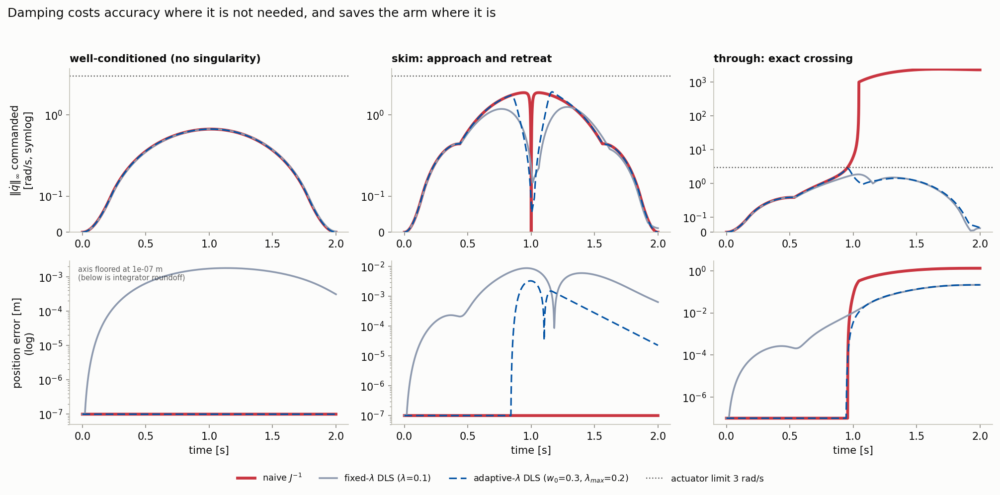
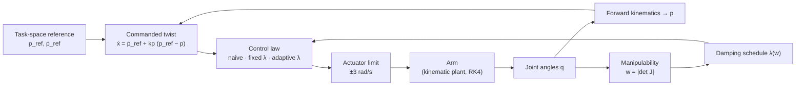

# singularity-robust-control

[](https://github.com/raahimnawaz/singularity-robust-control/actions/workflows/ci.yml)
[](LICENSE)
[](https://www.python.org/)

A manipulator controller that sees a kinematic singularity coming and adds just enough damping to keep joint velocities bounded through it, compared against the naive inverse-Jacobian controller that fails there.

> **Used in** [workbench-copilot](https://github.com/raahimnawaz/workbench-copilot), whose SO-101 arm solves its inverse kinematics with the damped-least-squares method studied here.



## Results

A planar 3R arm follows a straight line in task space that passes exactly through a singular configuration, with a 3 rad/s actuator limit.

| | naive J⁻¹ | fixed-λ damping | adaptive-λ damping |
|---|---:|---:|---:|
| Peak commanded joint speed | 2,434 rad/s | **1.86 rad/s** | 2.78 rad/s |
| Time at the actuator limit | 52.2 % | **0 %** | **0 %** |
| Position error, RMS | 0.740 m | **0.103 m** | 0.104 m |

- **Damping keeps the arm controllable.** The naive controller drives into the singularity, saturates for half the run and never recovers. Both damped laws stay within the actuator limit.
- **Fixed damping protects slightly better than the adaptive schedule** when the arm really crosses a singularity.
- **The adaptive schedule wins everywhere else.** On a path that stays clear of singularities it is identical to the naive controller, while fixed damping still costs 1.2 mm of tracking error. The inner 90 % of the arm's reach is well-conditioned, so that is most paths.

So scheduling the damping buys selectivity, not better protection. Every scenario and number is in [docs/results.md](docs/results.md).

## How it works



- **Where the singularity is.** The arm tracks its full pose (x, y, φ), so the Jacobian is square and its determinant has a closed form: `det(J) = l1 · l2 · sin(q2)`. The arm is singular exactly when its first two links line up. [Derivation](docs/derivation.md).
- **How close it is.** Manipulability `w = |det(J)|` falls to zero at the singularity, and the controller watches it.
- **The three control laws:**

  ```
  naive      q̇ = J⁻¹ ẋ
  fixed      q̇ = Jᵀ (J Jᵀ + λ² I)⁻¹ ẋ,   λ constant
  adaptive   same, with λ² = λ_max² (1 − w/w₀)² when w < w₀, otherwise 0
  ```

- **Why damping works.** `J Jᵀ + λ² I` stays invertible even when `J` itself is singular, so the commanded joint speed stays bounded.
- **Built to port.** All three laws share one explicit 3×3 inverse with no allocation, so the same math runs as C++ inside a 1 kHz loop.

## Prior work

Damped least squares is the standard answer to kinematic singularities, and this repo does not claim to invent it. It reimplements the established methods and measures them against each other on a case where the truth is known exactly.

- **Damped least squares:** Nakamura & Hanafusa (1986), Wampler (1986).
- **Damping scheduled on manipulability:** the form used here follows Nakamura & Hanafusa and Chiaverini (1997).
- **Related approaches:** numerical filtering (Maciejewski & Klein, 1988) and selectively damped least squares (Buss & Kim, 2005).
- **In production:** MoveIt Servo takes a different route, slowing the commanded motion as the Jacobian's condition number rises and stopping at a hard threshold.

## Implementations

| | Status |
|---|---|
| Python simulation (kinematic plant, RK4 at 1 ms) | Done, 74 tests |
| Header-only C++ port | Matches the Python reference within 1e-9; one control step takes about 0.1 µs |
| `ros2_control` plugin on a Webots arm | Runs; the published manipulability and damping match hand calculation. The three-law comparison has not been re-run here yet |

Details in [docs/implementation.md](docs/implementation.md).

## Quickstart

```bash
uv venv --python 3.12 && uv pip install -e ".[dev]"
uv run pytest -q                                   # 74 tests
uv run python -m armsim.run_experiment --sweep     # regenerates every figure and number

cmake -S cpp -B cpp/build -DCMAKE_BUILD_TYPE=Release && cmake --build cpp/build
ctest --test-dir cpp/build --output-on-failure     # C++ vs Python parity

docker build -f ros2/Dockerfile -t singularity-arm-webots .
docker run --rm --shm-size=1g singularity-arm-webots   # ROS 2 + Webots, headless
```

## Limitations

- **The results come from a kinematic plant.** Joint velocities are integrated directly, with no mass, inertia or torque limits. The 2,434 rad/s is what the naive law asks for, not what a motor could deliver.
- **The comparison on the dynamic Webots arm is still pending.** The prediction it will test is written down in [docs/PLAN.md](docs/PLAN.md): dynamics should shrink the naive controller's headline and strengthen the smoothness case for adaptive damping.
- **A planar 3R arm is the simplest useful case.** Its singularities can be derived by hand. A real arm needs an SVD-based measure instead of a closed-form determinant.

## Future plans

- **Run the pending comparison on the dynamic Webots arm**, to see how mass, inertia and torque limits change the three-way result.
- **Add MoveIt's slow-down-and-stop method as a fourth controller.** MoveIt Servo scales motion down as the Jacobian's condition number rises and stops at a hard threshold, which is the approach most ROS arms use today.
- **Move to a 7-DOF arm.** A redundant arm has a non-square Jacobian, so manipulability comes from the singular values, and the spare degree of freedom can steer away from singularities instead of only damping through them.

## More detail

- [docs/results.md](docs/results.md): all three scenarios, the workspace singularity map and its closed-form check, and how the damping parameters were chosen
- [docs/implementation.md](docs/implementation.md): the C++ port and its timing, the ROS 2 plugin and Docker setup, and a map of the code
- [docs/derivation.md](docs/derivation.md): forward kinematics, Jacobian and determinant by hand
- [docs/lessons.md](docs/lessons.md): the reference trajectory that quietly broke the experiment
- [docs/PLAN.md](docs/PLAN.md): roadmap and open questions
- [results/metrics.md](results/metrics.md): every number for all nine runs

## License

MIT, see [LICENSE](LICENSE).
