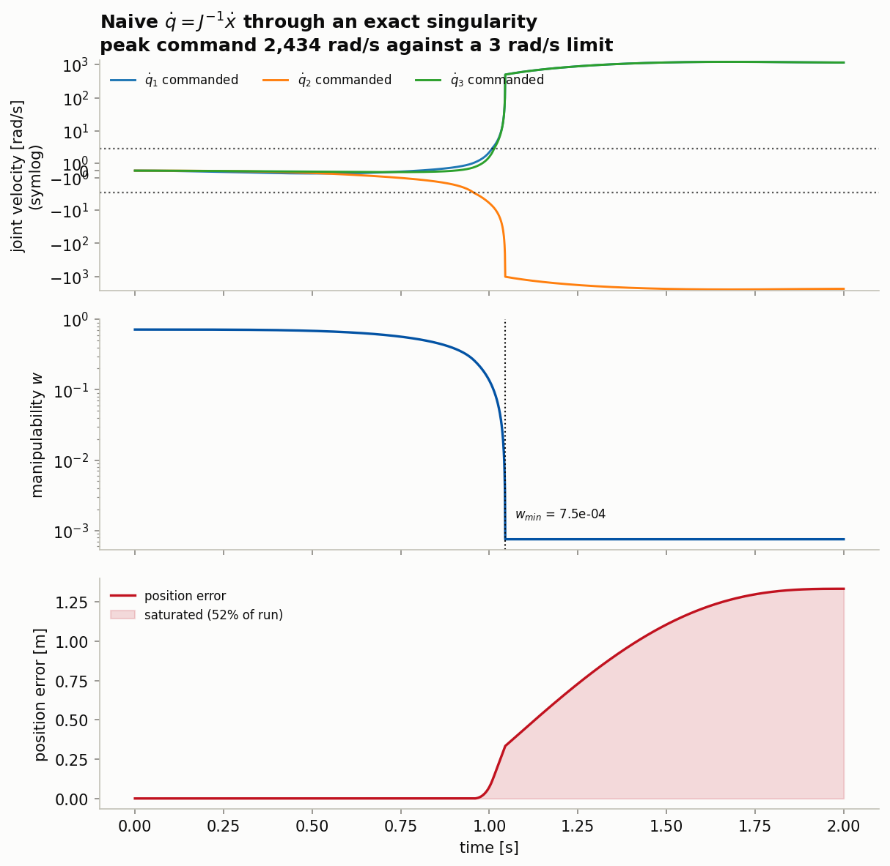
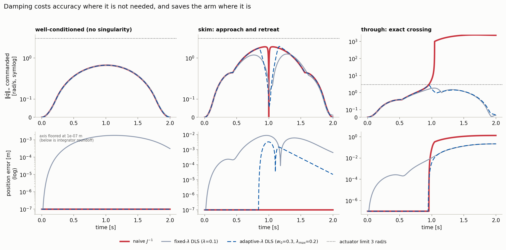
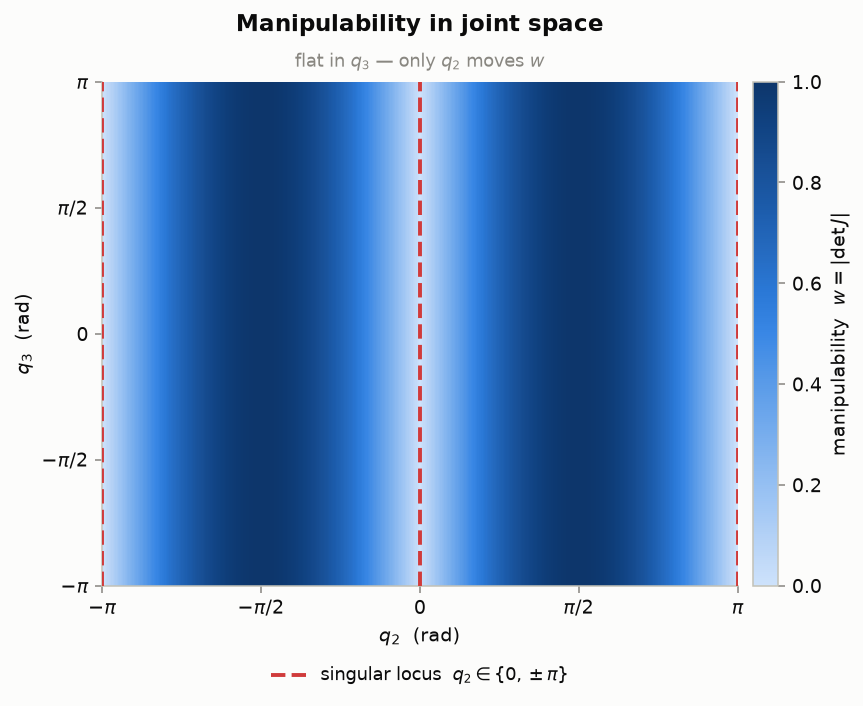
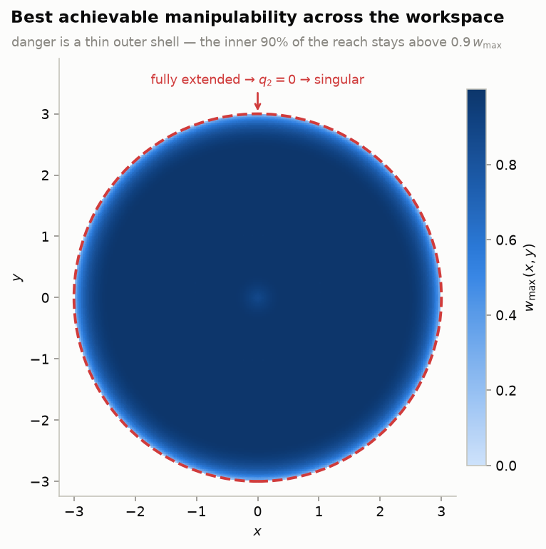
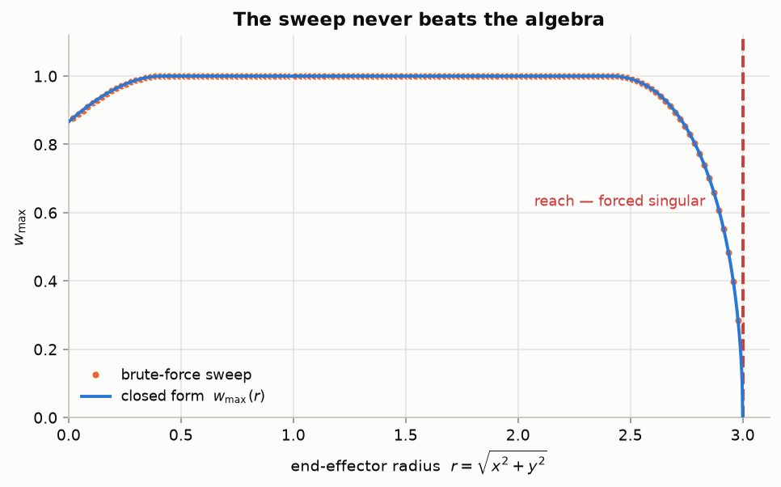
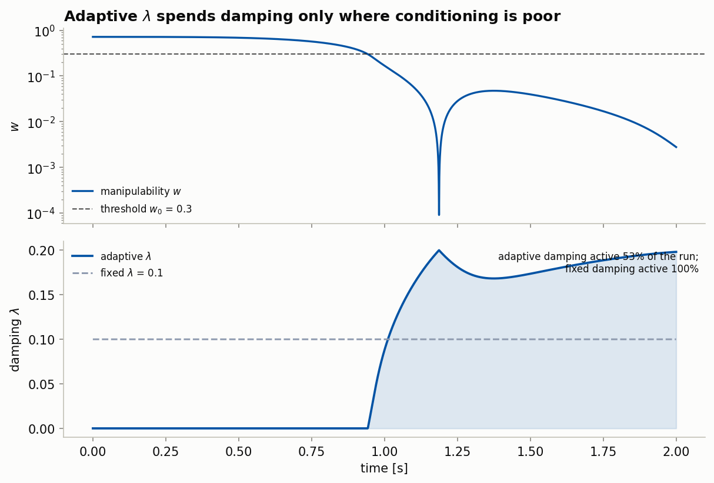
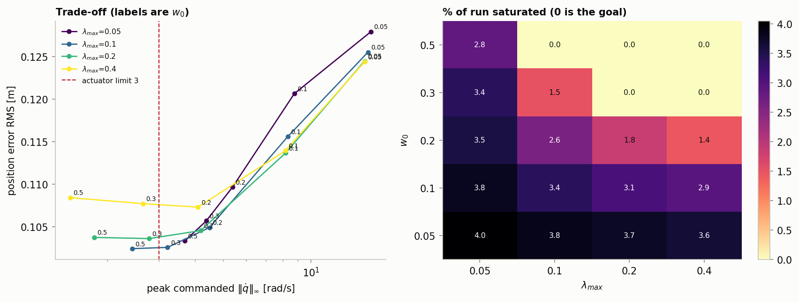

# Results in detail

The full write-up behind the [README](../README.md) summary: all three scenarios, where the singularities sit in the workspace and how that map is checked, and how the damping parameters were chosen. Every figure and number here is regenerated by `uv run python -m armsim.run_experiment --sweep`.

## The headline result

Same arm, same trajectory, same 3 rad/s actuator limit. A straight task-space line
driven **exactly through** a singular configuration at the trajectory's peak speed:

| | naive `J⁻¹` | adaptive-λ DLS |
|---|---:|---:|
| peak commanded ‖q̇‖∞ | **2,434 rad/s** | **2.8 rad/s** |
| time saturated | **52.2 %** | **0 %** |
| position error RMS | **0.740 m** | **0.104 m** |
| position error max | 1.335 m | 0.217 m |

**875× less peak joint velocity, and it never asks the actuators for something they
cannot deliver.** The naive controller does not merely overshoot — it drives the arm
into the singular configuration, saturates for over half the run, and never recovers.



The honest part is what damping *costs*, which is why the comparison runs three
scenarios rather than one:



Read the left column: on a trajectory that never approaches a singularity, the
adaptive law is **bit-identical** to the naive inverse — its schedule returns
`λ = 0`, so there is nothing to pay. Fixed-λ damping, by contrast, is paying
1.2 mm of tracking error for protection nothing needed. That property is the
argument for scheduling damping rather than fixing it, and it is asserted in the
tests, not just plotted.

**And the part that cuts against the adaptive law.** Once you are *actually*
crossing a singularity, scheduling does not buy better protection than a
well-chosen constant `λ` — it is slightly worse:

| through-crossing | peak ‖q̇‖∞ | pos RMS | accel RMS |
|---|---:|---:|---:|
| fixed-λ (0.1) | **1.86** | **0.1025 m** | **2.5** |
| adaptive-λ | 2.78 | 0.1036 m | 4.2 |

Fixed-λ wins on every column of the headline scenario. So the case for
scheduling is *not* "it handles singularities better" — it is narrower and
should be stated as such: **scheduling costs nothing when damping isn't needed,
which is most of the workspace** (the inner 90% of the reach radius, per Phase
2), while a constant `λ` taxes every trajectory whether or not it goes anywhere
near a singular configuration. Adaptive-λ buys selectivity, not protection. If
you know in advance that every trajectory crosses a singularity, use fixed-λ and
skip the schedule.

Full numbers for all nine runs: [`results/metrics.md`](../results/metrics.md).

## Where the singularities are (Phase 2)

```bash
uv run python -m armsim.run_heatmap        # writes results/
```

**In joint space** the map is flat in `q3` and zero exactly on `q2 ∈ {0, ±π}`.
That flatness is the visual proof of the derivation — folding link 3 does
*nothing* to conditioning, which is the opposite of an earlier guess about this
arm.



**In the workspace** the question isn't "what is `w` here" — a point can be
reached by several configurations with different `w` — but *how well-conditioned
can I be while standing here?* So the map shows the best case,
`w_max(x, y) = max{ w(q) : FK(q) = (x, y) }`.



The result is the headline of this phase, and it sets up Phase 3: **reaching far
costs conditioning, but only right at the end.** The inner **90%** of the reach
radius stays above `0.9·w_max`; the arm only has to straighten — driving
`q2 → 0` — in a thin outer shell. Danger is not spread across the workspace, so
the Phase 3 trajectory has to *aim* at a singularity to hit one.

**And it's checked, not asserted.** Because `q1` only rotates the arm and `w`
doesn't depend on it, `w_max` is a function of radius alone and has a closed
form — twice the area of the base–joint2–wrist triangle, by Heron:

```
w_max(r) = ½·√( ((l1+l2)² − r2²)·(r2² − (l1−l2)²) )   maximised over the
                                                     feasible wrist radius r2
```

A brute-force sweep of a few million configurations is then held to it. It never
wins, and the gap closes as the sweep refines — which is a test, not just a
picture:



## The control laws (Phases 3–4)

```
naive      qdot = J⁻¹ xdot
fixed      qdot = Jᵀ (J Jᵀ + λ²I)⁻¹ xdot,   λ constant
adaptive   qdot = Jᵀ (J Jᵀ + λ²I)⁻¹ xdot,   λ² = λ_max²(1 − w/w₀)² for w < w₀, else 0
```

All three share one explicit 3×3 cofactor inverse — no `np.linalg.solve`, no SVD.
That is not a micro-optimisation, it is the Phase 5 constraint: this has to become
dependency-free C++ inside a 1 ms budget, so it stays a fixed instruction sequence
with no allocation. Note the DLS form inverts `J Jᵀ + λ²I`, which is symmetric
positive-definite for any `λ > 0` — well-conditioned by construction even when `J`
itself is exactly singular. Avoiding the ill-conditioned inverse *is* the method.

### Where the damping goes



`λ` ramps continuously from 0 at the threshold to `λ_max` at the singularity.
Continuity is not cosmetic: a step in `λ` shows up as a joint-acceleration spike,
which is what the smoothness metric exists to catch.

### Choosing (w₀, λ_max)



The defaults (`w₀ = 0.30`, `λ_max = 0.20`) come from this sweep, not from taste —
it is the cheapest corner of the grid that reaches 0% saturation.

**The surprise here is that the trade-off is weak.** Pushing `w₀` from 0.05 to
0.30 cuts peak commanded velocity roughly 6× *while tracking error slightly
improves*. Damping earlier is nearly free, because in this regime the error was
coming from saturation rather than from the damping. The genuine cost only appears
at `λ_max = 0.4`, where the error curve turns back upward. A weak trade-off is
still worth plotting — the interesting claim is that it is weak, and that is only
credible with the grid shown.
